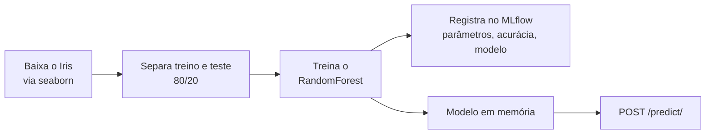

# xpemlflow

Exemplo de MLOps em Python: uma API [FastAPI](https://fastapi.tiangolo.com) que treina um `RandomForestClassifier` com o dataset Iris, registra cada treino no [MLflow](https://mlflow.org) e responde previsões por HTTP.

O projeto é didático. Cabe em um arquivo só ([`app.py`](app.py)) para mostrar, de ponta a ponta, o caminho entre treinar, rastrear e servir um modelo.

## Como funciona

O treino acontece quando o módulo é importado, antes de a API aceitar requisições:



Cada início da aplicação cria um novo run no experimento `Iris_Classification_Experiment`, gravado na pasta local `mlruns/`.

| Hiperparâmetro | Valor |
|---|---|
| `n_estimators` | 100 |
| `max_depth` | 5 |
| `random_state` | 42 |

## Endpoints

| Método | Rota | O que faz |
|---|---|---|
| `GET` | `/health` | Verificação de saúde. Retorna `{"status": "ok"}` |
| `POST` | `/predict/` | Recebe as quatro medidas da flor e retorna a espécie prevista |
| `GET` | `/docs` | Documentação interativa gerada pelo FastAPI |

Exemplo de previsão:

```bash
curl -X POST http://localhost:8000/predict/ -H "Content-Type: application/json" -d "{\"sepal_length\": 5.1, \"sepal_width\": 3.5, \"petal_length\": 1.4, \"petal_width\": 0.2}"
```

```json
{"predicted_species": "setosa"}
```

O arquivo [`rest.http`](rest.http) traz as mesmas chamadas para a extensão REST Client do VS Code.

## Como rodar

Requisitos: Python 3.11 ou superior, [Poetry](https://python-poetry.org) e internet na primeira execução, porque o dataset é baixado pelo seaborn.

```bash
poetry install --no-root
```

```bash
poetry run python app.py
```

A API sobe em `http://localhost:8000`. Para usar outra porta, defina a variável de ambiente `PORT`.

Para ver os experimentos, rode na mesma pasta:

```bash
poetry run mlflow ui
```

A interface do MLflow abre em `http://127.0.0.1:5000`.

## Testes

```bash
poetry run pytest
```

[`test_api.py`](test_api.py) verifica o `/health` e uma previsão para cada uma das três espécies. Importar a aplicação dispara um treino, então os testes também criam um run em `mlruns/`.

## CI e deploy

O workflow [`ci.yml`](.github/workflows/ci.yml) roda a cada push na `main`: instala as dependências, executa os testes e chama a API do Render para iniciar um deploy. Se o Render recusar a chamada, o job falha.

Configure dois secrets em **Settings > Secrets and variables > Actions**:

| Secret | Conteúdo |
|---|---|
| `RENDER_API_KEY` | Chave da API do Render |
| `RENDER_SERVICE_ID` | ID do serviço no Render (começa com `srv-`) |

## Estrutura

```text
.
├── app.py                    # treino, registro no MLflow e API
├── test_api.py               # testes dos endpoints
├── rest.http                 # chamadas de exemplo
├── pyproject.toml            # dependências (Poetry)
└── .github/workflows/ci.yml  # testes e deploy
```

## Limitações conhecidas

- **Sem validação de domínio:** a API aceita qualquer `float`, inclusive medidas negativas.
- **Treino a cada início:** a API depende da internet para baixar o dataset (na ausência de cache) e demora mais para subir.
- **Modelo não é recarregado do MLflow:** a API usa o modelo treinado em memória. O MLflow só registra o run.
- **Rastreio local:** em hospedagens com disco efêmero, os runs em `mlruns/` se perdem a cada deploy.
- **Sem lockfile:** o `poetry.lock` está no `.gitignore`, então as versões instaladas podem mudar entre builds.
